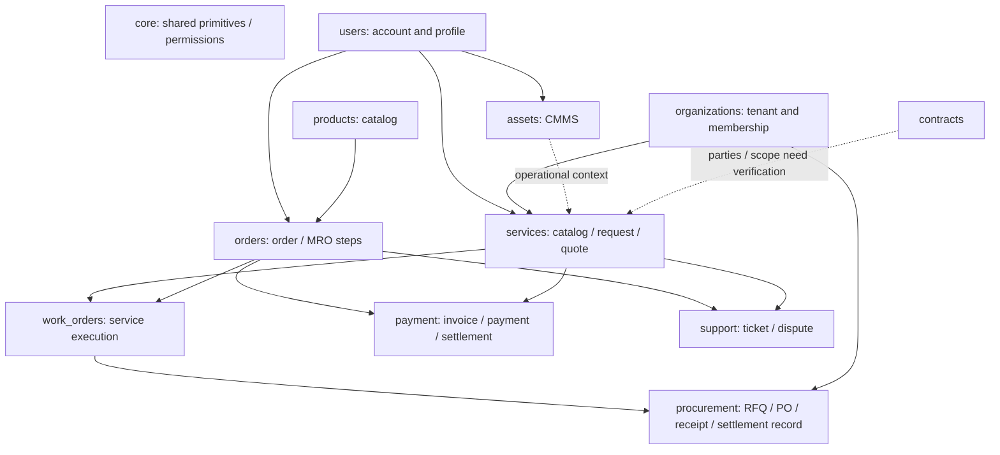

# Dependency Map

## Observed high-level dependency direction

Solid arrows are known direct/high-level coupling recorded by the baseline or visible in app relationships; dashed arrows represent conceptual relationships that need source-level verification before being treated as dependency contracts.

## Findings

- `users` is a broad dependency for business domains; identity/profile concerns are not cleanly bounded.
- `payment` directly depends on `orders` and `services`, making changes to commercial lifecycles financially sensitive.
- `services` is the principal code hotspot; `services/views.py` is large and combines substantial behavior.
- `assets` is a substantial operational domain, not CRUD-only.
- `core` should contain reusable technical primitives, not accumulating domain rules.
- Cross-domain imports and model references should be inventoried and minimized before refactoring.

## Change rules

Before changing shared models, record dependents, API consumers, migrations, signals, serializers, and frontend callers. Use an ADR for a cross-domain or API-contract change. Keep one migration stream modifying shared database foundations at a time. Prefer domain-owned services/events or explicit interfaces over new uncontrolled imports.

## Evidence and limits

This is a Phase 0 source-level map, not a complete import graph or runtime call graph. Confirm exact edges from model foreign keys, imports, signal registrations, URL includes, and production settings before using it for a migration plan. See [baseline](../../ARCHITECTURE_BASELINE_V1.md).
