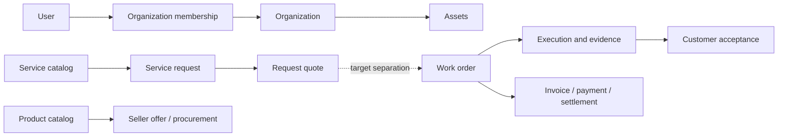

# InduService System Overview

**Baseline:** Phase 0 — Freeze & Audit. This document describes repository evidence, not a claim that every flow is production-ready. See [Architecture Baseline v1](../../ARCHITECTURE_BASELINE_V1.md).

## Product shape

InduService is a B2B industrial services and MRO marketplace. The repository combines a Django REST Framework backend (`backend/InduService`, `backend/apps/*`) and a React/Vite frontend (`frontend/src`). The backend is organized as Django apps; the frontend has feature folders alongside a substantial route-level `pages/` layer.

## Current business capabilities

- Identity and profiles (`users`) plus organization and membership (`organizations`).
- Service catalog, requests, matching, and request quotes (`services`).
- Orders and MRO workflow steps (`orders`); a canonical WorkOrder domain is not present in the inspected model inventory.
- Asset records, maintenance, alerts, sensors, schedules, imports, hotspots, and predictions (`assets`).
- Product catalog (`products`), contracts/transfers/milestones (`contracts`), finance (`payment`), reviews, support/disputes, subscriptions, notifications, blog, and settings.

## Runtime shape

The browser application calls API services through the shared Axios client and feature API modules. React Router defines public, authenticated, provider, buyer, and administrative route surfaces. React Query is installed for server state; Zustand stores cover authentication and global UI/theme state. The exact production deployment topology and live database state are outside repository-only verification.

## Intended conceptual flow

Dashed/target concepts in this diagram are not asserted as implemented. In particular, the inspected code has `ServiceRequestQuote`, `Order`, and `MROWorkflowStep`, but not a canonical `WorkOrder` model or a first-class procurement lifecycle.

## Architecture constraints during the freeze

1. Do not add business features or speculative business models.
2. Preserve existing public API behavior unless a reviewed migration/deprecation plan says otherwise.
3. Keep business lifecycle state separate from financial state.
4. Enforce tenant and actor authorization on the server for every operation and file.
5. Document cross-domain changes and migration impact before implementation.

## Known risks and verification limits

The Phase 0 baseline flags production database configuration, browser token persistence, permission consistency, oversized service views, overloaded `users.Profile`, and payment coupling for remediation/review. Runtime database parity, deployed headers/secrets, production authorization, and backup/restore remain unverified. See [dependency map](dependency-map.md), [database architecture](database-architecture.md), and [API contract](../api/api-contract.md).

## Sources

- [Phase 0 baseline](../../ARCHITECTURE_BASELINE_V1.md)
- [Execution master plan](InduService-Architecture-Execution-Master-Plan-v1.0.md)
- Backend app and model source under `backend/apps/`
- Frontend routes and feature source under `frontend/src/`
